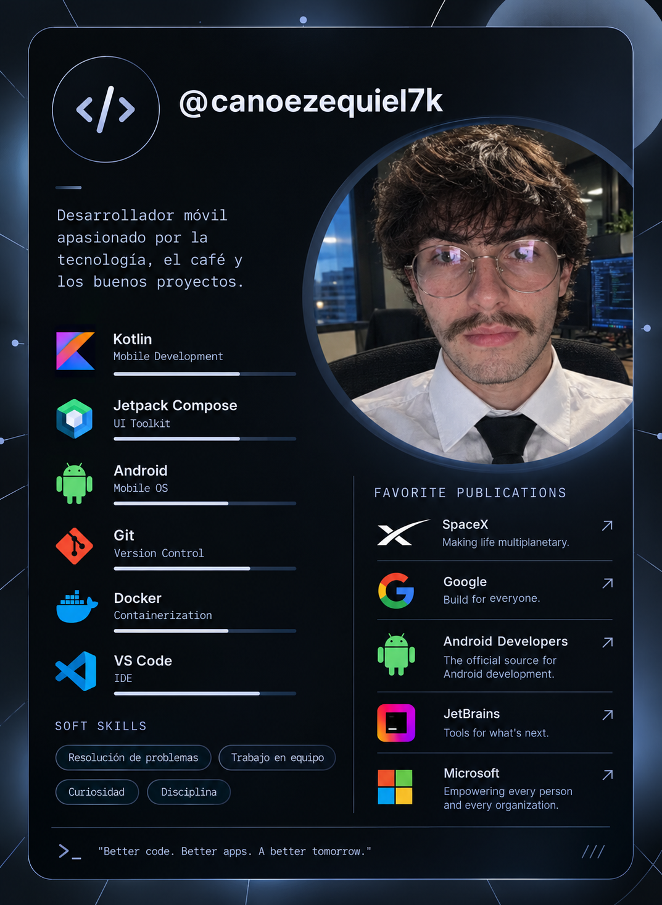

# Hola, soy Ezequiel Cano 👋

### Técnico en Programación · Estudiante de Sistemas · Desarrollador Mobile & Frontend

  
  
  
  

## Desarrollador mobile y frontend

Me gusta diseñar y desarrollar productos digitales, especialmente **aplicaciones móviles**. Trabajo en proyectos full stack y mi mayor interés está en el **frontend**, donde puedo combinar programación, diseño y experiencia de usuario.

Busco seguir creciendo como desarrollador, participar en proyectos reales y crear soluciones útiles con código claro, buenas prácticas y arquitecturas mantenibles. Disfruto aprender haciendo, recibir feedback y colaborar en equipo. Fuera del código, juego al ajedrez. ♟️

 

  
  
  
  
  

## 🧭 En qué estoy enfocado

- Desarrollo móvil con **Kotlin**, **Android** y **Jetpack Compose**
- Interfaces y experiencias frontend centradas en las personas
- Desarrollo full stack, APIs REST e integración con bases de datos
- Aprendizaje continuo, código limpio y diseño de software mantenible

 

## 🛠️ Tecnologías y herramientas

  
  
  
  
  
  
  
  
  
  
  
  
  
  
  

**También trabajo con:** Dart, APIs REST, Room, MVVM, Clean Architecture, Git/GitHub, Linux/Ubuntu, Gradle, Android Studio y Visual Studio Code.

## 🚀 Proyectos destacados

### 📱 [Mimun — Diario emocional](https://github.com/canoezequiel7k-sys/Mimun)

Aplicación móvil para registrar estados de ánimo, escribir reflexiones y consultar estadísticas emocionales. Incluye experiencia Android nativa, almacenamiento local y uso offline, junto con una API para sincronizar los datos.

**Tecnologías:** Kotlin, Jetpack Compose, Room, Python, FastAPI, PostgreSQL y Docker.

  
  
  

### ☕ [Somphie Zúrich — Gestión de cafetería](https://github.com/canoezequiel7k-sys/SomphieZurich)

Proyecto en desarrollo para gestionar la experiencia de una cafetería: pedidos mediante QR, herramientas para el personal y un panel administrativo. Actualmente cuenta con especificación funcional y bases técnicas; la API de negocio y las aplicaciones cliente todavía están pendientes de implementación.

**Stack previsto:** Kotlin, Jetpack Compose, React, TypeScript, Spring Boot y PostgreSQL.

### 👁️ [Webcam Object Detector](https://github.com/canoezequiel7k-sys/webcam_detecter)

Detector de objetos en tiempo real desde la webcam. Reconoce elementos mediante YOLOv8 y OpenCV, y permite guardar capturas automáticamente o de forma manual.

**Tecnologías:** Python, YOLOv8, OpenCV y NumPy.

### 💤 [Mimirn't — Asistente anti-sueño](https://github.com/canoezequiel7k-sys/Mimirnt)

Aplicación de escritorio que detecta cuando los ojos permanecen cerrados, activa una alarma y puede ejecutarse en segundo plano desde la bandeja del sistema.

**Tecnologías:** Python, OpenCV, MediaPipe, Pygame y pystray.

## 💼 Experiencia

- **Desarrollador de aplicaciones — COTO** · ago. 2025 – may. 2026  
  Mantenimiento y actualización de aplicaciones utilizadas en distintas sucursales.
- **Desarrollador full stack — Apart JH Belgrano Nordic** · sep. 2025  
  Desarrollo de una aplicación de escritorio para administrar habitaciones, reservas, ocupación, check-in/check-out y reportes de estadía.
- **Desarrollador web independiente** · may. 2023 – sep. 2025  
  Creación de sitios y aplicaciones web funcionales y adaptados a las necesidades de cada cliente.
- **Frontend Developer — Enta Consulting** · nov. 2023 – feb. 2024  
  Mejoras de diseño, funcionalidad y experiencia de usuario en el sitio web de la empresa.

## 🎓 Formación

- **Licenciatura en Sistemas — Universidad Nacional de Lanús (UNLa)** · En curso
- **Técnico en Programación — Universidad Tecnológica Nacional (UTN)**

## 🌱 Mi camino de aprendizaje

Aprendo construyendo proyectos, explorando nuevas tecnologías y mejorando cada iteración a partir del feedback. Me interesa fortalecer mis habilidades de desarrollo móvil y frontend, asumir nuevos desafíos y aportar a equipos que valoren la colaboración, la responsabilidad y la calidad del software.

## 🤝 Conectemos

- [GitHub](https://github.com/canoezequiel7k-sys)
- [LinkedIn](https://www.linkedin.com/in/canoezequiel7k-sys/)
- [Instagram](https://www.instagram.com/canoezequiel7k/)
- [X](https://x.com/canoezequiel7k)

  
  

*Por privacidad, no publico mi dirección de correo personal en este perfil.*
